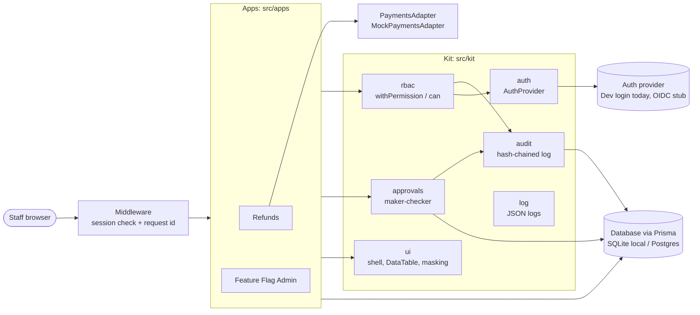

# Acme Internal Tools Kit

A proof of concept for replacing Microsoft Power Apps with an internal-tools kit that Acme's engineers own. Most of the value is in the shared governance layer in `src/kit`: pluggable authentication, server-side role-based access control, a hash-chained audit log written in the same transaction as every change, and maker-checker approvals. Apps such as **Refunds** and **Feature Flag Admin** are thin screens and policies built on top of it. It is a Next.js (App Router) + TypeScript app with Prisma: SQLite for local development and tests, Postgres for the production-like Docker run.

## Architecture



Every server action and route handler goes through `withPermission` (ADR 001). Every write records an audit event in the same transaction (ADR 002). Sensitive changes become approval requests that a different person must approve (ADR 003).

## Quick start (local, SQLite)

Requires Node 20.

```bash
npm install          # also creates .env with a random SESSION_SECRET and generates the Prisma client
npm run db:reset     # migrate + seed prisma/dev.db
npm run dev          # http://localhost:3000
```

Checks: `npm run lint`, `npm run typecheck`, `npm test`, `npm run build`, then `npm run e2e` (Playwright; run `npx playwright install chromium` once). CI runs all of them on every PR (`.github/workflows/ci.yml`).

## Quick start (Docker, Postgres)

```bash
docker compose up --build    # http://localhost:3000
```

The app container runs `prisma migrate deploy` against Postgres, seeds once (skipped after a completed seed; a half-finished seed stops startup with an error so you reset the volume), then starts `next start` as a non-root user. `GET /api/health` returns 200 when the database is reachable and 503 otherwise. Set `SESSION_SECRET` in your shell to keep sessions across restarts. Compose enables the DEV ONLY login for demo purposes.

`DATABASE_URL` selects the database: `postgresql://…` uses `prisma/postgres/schema.prisma` (generated from `prisma/schema.prisma` by `npm run db:postgres-schema`; CI fails if it's stale), anything else uses SQLite. `scripts/prisma.mjs` makes that choice for every Prisma command.

## Demo script

All users are seeded and listed on `/login` (DEV ONLY, no password).

1. **Large refund (maker-checker):** sign in as `agent@acme.test`. Open **Refunds**, pick a payment over $1,000, and issue a **$50** refund: it's processed immediately. Issue a **$900** refund: it goes to *pending approval*. Open **Approvals**: the agent sees it under "My requests" but can't approve it.
2. Sign out and sign in as `approver@acme.test`. Under **Approvals → Waiting for me**, approve the $900 refund. It's issued through the payments adapter.
3. **Feature flag in prod:** sign in as `eng@acme.test`. Open **Feature flags**, pick a flag, change dev or staging directly, then request a prod change. Sign in as `eng2@acme.test` and approve it under **Approvals**. A prod kill switch request is marked URGENT.
4. **Audit:** sign in as `admin@acme.test`. Open **Audit log**, expand a row to see the before/after diff, click **Verify integrity**, and export CSV.
5. **Denied access:** as `viewer@acme.test`, open `/admin/audit`. You're sent to the Forbidden page, and an `access_denied` event appears in the audit log.

## Adding an app

Follow [docs/ADDING_AN_APP.md](docs/ADDING_AN_APP.md). Architecture decisions are in [docs/adr](docs/adr). Scope, tradeoffs and how Devin was used are in [docs/KEY_DECISIONS.md](docs/KEY_DECISIONS.md).

## Security notes

- Session cookie `itk_session`: iron-session sealed, `httpOnly`, `sameSite=lax`, `secure` in production, 8-hour TTL. Production refuses the dev login (unless `ALLOW_DEV_AUTH_IN_PRODUCTION=true`) and the example secret.
- Headers on every response: Content-Security-Policy, `X-Frame-Options: DENY`, `Referrer-Policy: strict-origin-when-cross-origin`, `X-Content-Type-Options: nosniff`, Permissions-Policy, and HSTS in production.
- Guardrail tests: `src/security.test.ts` fails if a server action or route handler runs for an anonymous caller (apart from the reviewed sign-in, sign-out and health exceptions), and if any form schema accepts unknown fields. `src/kit/coverage.test.ts` fails if an exported kit function has no test.
- Logs are one JSON object per line with `requestId` (from the `x-request-id` header, generated if missing and echoed in the response).

## Production gaps

These are known and deliberate for a proof of concept. Each needs an owner before production.

- **OIDC is a stub.** `OidcAuthProvider` has TODOs for Entra ID / Okta. Until it's done, the only working login is the passwordless DEV ONLY picker.
- **Mock payments adapter.** `MockPaymentsAdapter` stands in for Stripe/Adyen; there is no real processor integration.
- **Payment call inside the DB transaction, no outbox.** The processor is called while the refund transaction is open. A real integration should write an outbox row and call the processor after commit.
- **Refunds with an unknown outcome need reconciliation.** If the processor call fails ambiguously, the amount stays reserved until an approver clicks "Check with processor". There is no automatic reconciliation job.
- **No data retention policy** for audit events, customer data or the mock processor record.
- **No SIEM export.** The audit log lives in the app DB with CSV export only; logs go to stdout.
- **No backups** or restore drill for the database, and no off-site anchoring of the audit chain head.
- **No per-environment deploy pipeline.** CI checks PRs only; there is no staging/prod promotion, secrets management or infrastructure as code.
- **No load testing.**
- **CSP allows `'unsafe-inline'` scripts** because Next's inline hydration scripts aren't nonce-tagged yet.
- **Remaining `npm audit` findings** that need major upgrades are listed in the handover PR.
